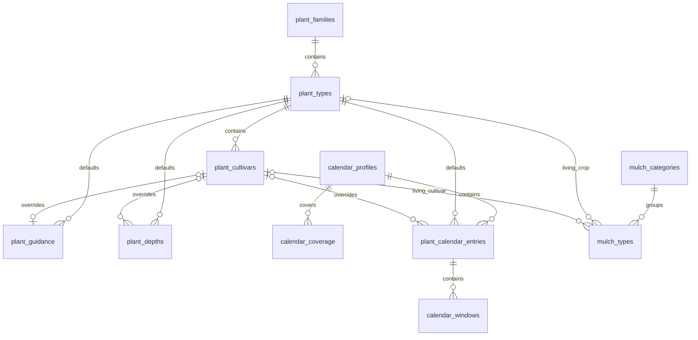

# Plant catalogues

## Using the catalogue

Open **Your gardens → Catalogue** from the garden name or the More menu. The empty
workspace also has a **Catalogue** button. This dedicated page unifies plants,
calendars, seed mixtures and mulch using one grouped section selector. Catalogue management is
absent from garden, bed and area editors; their planning fields stay unchanged.
Save or cancel an entry before switching section or returning to gardens.
Opening the page keeps the garden editor mounted to preserve its current draft.

There is one catalogue for the whole app. All signed-in users may browse and
search its families, plant types and companion rules. Administrators may add and
edit entries. Garden ownership or editor access does not grant this role.
The catalogue starts empty; it contains no preset horticultural advice.

Families have a name, notes and optional default distances between plants in a
row and between rows. Plant types belong to a family and may override either
distance independently. Empty plant-type distances inherit the corresponding
family default. If both are empty, that recommendation is unknown. Distances
are positive centimetres and may be fractional. Reference distances are retained
exactly; this does not change the garden's existing 5 cm drawing grid.

Plant types also define a **Minimum border distance** in cm, initially 15 cm.
It must be at least 5 cm in steps of 5 cm and does not inherit from the family.
The planner centres rows and plants while respecting this minimum; rows move
closer only when necessary. Plant references capture the border distance, so
editing the catalogue does not rewrite saved plans or history.

Companion rules connect any pair of families or plant types. They can record a
companion suggestion or a caution, with optional explanatory notes. The same
pair applies in both directions, so reversed duplicates are rejected. Rules
between the same family are also supported. Missing rules mean unknown.

Specificity determines advice: cultivar rules take priority over crop and family rules.
Among crop/family rules, plant/plant rules take priority over plant/family
rules, which take priority over family/family rules. When equally specific rules
disagree, caution takes priority and both rules remain available for explanation.

Each edit uses its loaded version. A stale save or revoked administrator role
shows an error and keeps the form open. Return to the catalogue and refresh to
load the latest entries. Families, crops and companion rules support creation and
editing. Cultivars and mulch types also support administrator removal as described
below. Saved planting and history references retain their captured identities.

## Database and administrators

Apply `supabase/migrations/202611160003_plant_catalogues.sql` once, after the garden
and sharing migrations. It creates `plant_families`, `plant_types`,
`companion_rules` and `catalogue_administrators`, with Row Level Security,
reference constraints, duplicate protection and version triggers. After subsequent
migrations, apply `202611160014_plant_border_distance.sql` for the border property,
admin-only column writes and matching saved-plan validation. Existing plant
types default to 15 cm, and older plan snapshots retain their implicit minimum.

Administrator membership is managed through a trusted database connection or
the Supabase SQL Editor. The browser cannot grant or revoke it, even for an
existing catalogue administrator. To add another confirmed account, replace the
example email and run:

```sql
INSERT INTO public.catalogue_administrators (user_id)
SELECT id
FROM auth.users
WHERE lower(email) = lower('new-admin@example.com')
  AND email_confirmed_at IS NOT NULL
ON CONFLICT (user_id) DO NOTHING
RETURNING user_id;
```

Check that the intended account exists if no row is returned. To revoke a role,
use the same trusted database connection to delete that account's membership.
Revocation affects its next write; it can still browse as a signed-in user.
No secret key or role is stored in the frontend, auth metadata or local storage.

## Planting guidance

The catalogue stores reference guidance. [Bed planting plans](planting.md) retain
the spacing and guidance used when applied, so catalogue edits do not silently
rewrite existing plans. Planning exceptions belong to the plan and may override
recommendations without editing this shared catalogue. Dated activities remain
separate work; [layout history](history.md) retains these plans in saved events.

Agreed defaults:

- Use the larger spacing requirement between different plant types and adjacent rows.
- Centre rows at the chosen spacing, maximising balanced border gaps with a 15 cm minimum. Compress row spacing only when needed to keep that minimum.
- Choose row direction independently per area, defaulting to the bed's longest dimension.
- Start new areas with 2 rows; allow a different explicit count or automatic spacing.
- Present companion suggestions and warnings with a way to proceed despite guidance.
- Store plant points relative to their bed and distinguish planned from actual dates.
- Support different mulch areas and ordered layers of different materials.
- Leave a 5 cm radius of uncovered soil around active plant points in each mulch layer.

The catalogue helpers resolve family defaults, symmetric companion advice and
the larger spacing recommendation. The planner provides row previews, counts,
planting areas and explicit spacing overrides. [Dated activities](activities.md)
distinguish planned work from completed bed checkpoints. Garden snapshots are
available in [layout history](history.md). The
[mulch catalogue](mulch.md) now defines reusable materials with the same
administrator role. Bed plans now support independent mulch areas and ordered
layers, with 5 cm clearances around plants.

## Verification

`npm test` covers the real migrations in isolated PostgreSQL, administrator role
provisioning/revocation, authenticated browsing, denied anonymous/non-admin writes,
role self-promotion prevention, foreign keys, duplicate pairs, revision conflicts,
spacing inheritance, companion precedence and Supabase repository requests.
Tests create no live users and populate no live catalogue data.

For browser review, open the catalogue as an administrator, add two families and
plant types, set defaults and overrides, and add a companion or caution rule.
Open it in an ordinary account to verify browsing without editing controls.

## Crops, cultivars and reference guidance

Apply `202611170018_catalogue_guidance.sql` after the earlier migrations. Existing
family, crop and material IDs remain unchanged. The hierarchy is **Family → Crop
→ Cultivar**, for example **Cucurbitaceae → Watermelon → Crimson Sweet**. A crop
can carry an optional scientific name; botanical species are not another table.
Select a crop without specifying a cultivar when the variety is unknown.

The catalogue has visible **Plants**, **Calendar**, and **Mulch** groups. Plants contains
crops, families, cultivars, and seed mixtures. Calendar opens the monthly growing
calendar; calendar profiles and coverage are administrator configuration. Mulch
contains materials, with category configuration available to administrators. Select a crop or cultivar
name, or **View details**, to open one page containing its identity, spacing, notes,
**Care guidance**, **Planting depths**, **Companions**, **Rotation rules** and **Growing
calendar**. All sections are visible together, without tabs or collapsed panels.
Administrators can edit every field directly. One persistent **Save** button saves
the entire crop or cultivar, including relationships and calendar windows, as one
transaction. Nothing is written until Save. **Discard changes** restores the whole
loaded draft; unsaved changes offer **Save and leave**, **Discard and leave**, or **Stay** when navigating, and warn before closing the page.
Failed saves keep every edit. The form checks crop/cultivar revisions as well as
changed guidance rows and inherited sources; stale or invalid changes roll back
all writes. Ordinary users see the same fields without editing controls.

The owner is fixed while editing. Empty care and spacing fields use the crop/family
recommendation shown in the field. Explicit **No** remains an override. Planting
depths are shown for every method; clearing an owned depth restores its inherited
value (or unknown). Editing an inherited companion, rotation or calendar row creates
an override for the selected crop/cultivar and preserves the source. Companions are two linked-plant lists: **Suggestions** and **Caution**. Rotations
use **Favourable after** and **Avoid after** lists of previous crops, cultivars or
families. Select a plant to add it, use the move control to change its list, and
remove or undo owned links before saving. A plant is listed once per relationship
type; inherited links use the most specific available recommendation. Relationship
notes are no longer displayed or edited; existing stored notes are retained.
Removing owned links takes effect with Save and can be undone before saving.

Apply `202611170028_crop_editor.sql` after 027 to enable the administrator-only
`myco_save_crop_editor` transaction. It permits only named catalogue fields and
rows belonging to the selected owner. Direct table deletion stays unavailable.

Apply `202611170027_catalogue_cultivar_relationships.sql` to add cultivar endpoints
for companions and rotations, preserving existing rule IDs and administrator access.
Relationship changes advance the affected crop/cultivar revisions. Cultivar removal
also removes relationships that reference it. Every signed-in user can browse; only catalogue administrators can
create or edit records. Garden owners/editors receive no catalogue privileges.
This applies to all new tables and the calendar-writing RPC, not just the UI.
Role provisioning remains outside the app. Administrator removal is limited to
cultivars and mulch types.

Cultivars inherit individual spacing, border distance and living-mulch eligibility
fields from their crop. Crop spacing still inherits family defaults. Care records
inherit each non-null field; explicit `false` overrides `true`. Planting depths
inherit by planting method. Rotation and companion rules inherit from the crop and family, with optional
cultivar-specific relationships. Guidance changes advance the owning crop/cultivar revision. Saved planting
references include optional cultivar ID, name and revision alongside the crop
identity and resolved spacing. Recaps distinguish cultivars.

Care guidance records sunlight, shade tolerance, rotation interval, organic-feed
level, feeding in planting holes, monthly feeding, watering changes before harvest
and watering notes. Depths distinguish seed, crown, bulb, tuber, sucker, offset
and plant methods. This is reference guidance; no work is scheduled automatically.

Rotation rules are directional (`favourable_after` or `avoid_after`), unlike
symmetric companion rules. Each endpoint references exactly one crop, cultivar or family. Broad source groups are expanded into explicit relationships during
import and their original labels are retained as notes.

### Calendar and location

Calendar profiles own administrative-region coverage and crop/cultivar activity
entries. Each activity/method entry owns zero or more month windows. Ranges may
cross December and may be disjoint. A cultivar entry replaces its crop's matching
activity/method entry; an explicitly empty entry means that activity does not
apply. Missing entries mean unknown. The atomic `myco_save_calendar_entry` RPC
checks the entry revision and replaces its windows in one transaction. Direct
window writes are denied even to catalogue administrators.

New gardens require a region from the dropdown, with an optional city name. The
list contains the twelve supported central/northern Italian regions. **Edit garden → Garden location** adds or updates
location for existing gardens. **More → Garden growing calendar** automatically
loads their region's calendar and resolves crop/cultivar overrides. Users cannot
manually select a calendar. Existing gardens without a location remain editable.
Location is current garden metadata, stored as `gardens.location` JSON, rather
than part of a historical layout snapshot. Layout autosaves do not overwrite it.

The initial profile is `central-northern-italy`, covering Piemonte, Valle d’Aosta,
Lombardia, Trentino-Alto Adige, Veneto, Friuli-Venezia Giulia, Liguria,
Emilia-Romagna, Toscana, Umbria, Marche and Lazio. Only coverage is seeded; no
horticultural recommendations are published by the migration.

Region selection saves `countryCode`, `regionCode` and a display name; an optional
`city` is trimmed and included in the display name. It requires no external lookup,
Edge Function or geocoding provider. Migration `202611170026_manual_garden_region.sql`
allows locations without coordinates. Existing locations remain valid and retain
their original metadata until edited. The optional latitude/longitude pair and
original entered-location label remain supported for future exact geocoding.
Changing the region or city replaces that metadata with the manual selection so
old coordinates are not associated with a different location.

### Database relationships



All new catalogue tables retain UUID identities, revisions and timestamps, column
write restrictions and administrator-only RLS. Cultivar/crop composite foreign
keys prevent cross-crop references. Calendar-profile revisions advance
when their coverage or activity entries change.

### Pak choi

**Pak choi** belongs to **Brassicaceae**, with the scientific name
*Brassica rapa* Chinensis Group.

The full-head spacing is **30 cm between plants × 50 cm between rows**, from
[Orto Mio](https://www.ortomio.it/piante-da-orto/cavolo-vario/asiatico-pak-choi-60-giorni).
The regional calendar uses spring and late-summer windows, adapted from
[Italian agronomist guidance](https://www.ortodacoltivare.it/ortaggi/pak-choi/)
and [RHS cultivation advice](https://www.rhs.org.uk/vegetables/pak-choi/grow-your-own).
Calendar notes contain only month ranges, matching the other crops; the regional
adaptation and sources are recorded separately in provenance. Watering notes use
the same short format as the other crops. Field-level source attribution is
retained in `catalogue_import_sources.source_data`. Unsupported feeding and
pre-harvest watering flags remain SQL `NULL`, rather than becoming `false`.

### Legacy Datterini conversion

Migration `202611170019_datterini_cultivar.sql` moves the deployment's original
**Tomatoes → Datterini** entry to **Solanaceae → Tomato → Datterini** after the
Tomato crop has been imported. It reuses Datterini's ID for the cultivar and keeps
its effective 50 cm plant spacing, 80 cm row spacing and 15 cm border distance as
overrides. The obsolete crop and empty Tomatoes family are removed through the
trusted migration; client deletion permissions remain unchanged.

Garden plans, recorded snapshots, history revisions and planned activities are
left unchanged and checked within the same transaction. Existing plans retain
their saved references; selecting Datterini again adopts the current cultivar
reference. The migration refuses unhandled catalogue dependencies, is a no-op
after conversion, and does nothing in fresh databases without the legacy entry.

### Removing cultivars and mulch types

Apply `202611170020_catalogue_removal.sql` to enable removal. Administrators see
**Remove** on cultivar cards in **Your gardens → Catalogue → Cultivars**, and
on material cards in **Mulch catalogue**. A confirmation names the selected entry.
Cancel makes no request; pending requests prevent duplicate removal or dismissal.
Failures keep the confirmation open, with stale entries requiring cancellation
and refresh. Ordinary users have no removal controls.

The `myco_remove_cultivar` and `myco_remove_mulch_type` RPCs require catalogue
administrator membership and the loaded revision. Direct table deletion remains
denied to clients. Removing a cultivar also removes its own care, depth and calendar
overrides, including month windows, in one transaction; parent crop guidance stays
intact. Calendar-profile revisions advance when their entries are removed. A living
mulch type referencing a cultivar must be changed or removed before that cultivar
can be removed. Unexpected foreign-key failures roll back all cleanup.

Existing garden plans, activities and history retain their saved snapshots. Removed
entries are absent from refreshed catalogues; saved references still display their
captured names and guidance. This operation does not remove crops, families, mulch
categories or other reference sections.


## Seed mixtures

Migration `202611170021_unified_areas_seed_mixtures.sql` adds `seed_mixtures` and
`seed_mixture_components`. Manage them in **Your gardens → Catalogue → Seed
mixtures**. Each component references a crop and optionally its cultivar and
specifies its percentage by seed weight. Components must be unique and total
100%; one to fifty components are supported.

All signed-in users can read mixtures. Only catalogue administrators can save
them, using the atomic, revision-checked `myco_save_seed_mixture` RPC. Direct table
writes are denied, including to frontend administrators. Deferred database
constraints also enforce complete composition when trusted tools write data.
Referenced cultivars cannot be removed while a mixture uses them.

Broadcast areas capture the mixture name, notes, revision and full component
plant snapshots. They store their own density in g/m². Catalogue changes never
rewrite saved area composition or history. See [Unified areas](areas.md).


## Navigation and growing calendar

The shared **Gardens**, **Catalogue**, and **Growing calendar** navigation is available
in garden, bed, and focused-area screens. Browsing preserves the mounted editor,
selection and controls. Contextual Back returns to the origin; changing gardens
continues to use the existing save checks. Catalogue section searches and list
positions are retained when browsing details or switching sections. Failed saves
keep all form values and prevent the requested navigation.

The growing calendar starts with the current month and all catalogue crops. Use
month arrows, **Today**, crop/variety search, and activity filtering; **In this garden**
restricts results to crops in the latest saved garden plan, including mixtures.
**Annual view** shows all twelve months. Variety results apply cultivar overrides
and label inherited activities. Crop details expose the existing care, depth, and
calendar editor. Month fields use month names. Regional coverage follows the active
garden; an explicit reference-profile choice is available when coverage is missing.
This is recurring seasonal guidance rather than a dated work or harvest prediction.

Apply `202611190029_calendar_cleanup.sql` after migration 028. It merges adjacent or
overlapping windows, including December–January adjacency, while preserving every
active month. Separate seasonal gaps remain separate. Only notes exactly repeating
the imported English month ranges are cleared; contextual notes remain. Both calendar
save paths use the same normalization and retain permissions and version checks.
Empty windows keep their existing meaning and are not converted to missing guidance.

The cleanup retains the original affected entry and window rows in
`calendar_cleanup_backup_202611190029`, inaccessible to application users. The optional
`supabase/rollbacks/202611190029_calendar_cleanup.sql` restores those notes and windows,
refusing to overwrite entries edited since cleanup. It preserves advancing revisions
and does not remove normalization from future saves. Reapplying the migration is safe.

The connected database was updated on 19 November 2026: 181 activities retained,
204 → 199 windows, 176 repeated notes cleared, and five contextual notes retained.
The checksum over all activity/month pairs was unchanged:
`505a9a081549fd02926ceee37d743339`.
